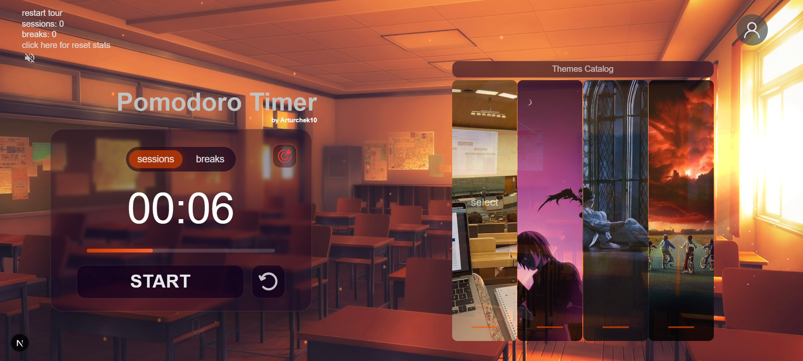
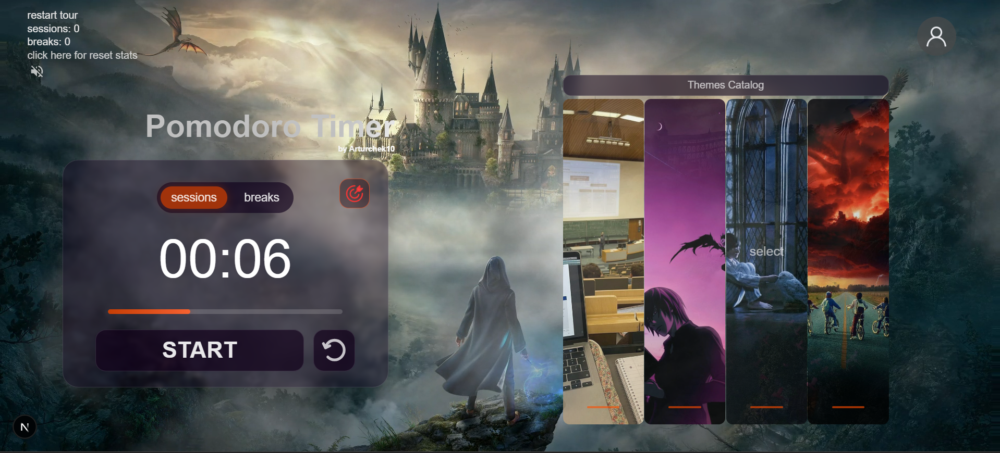
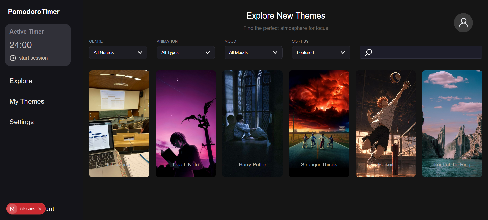
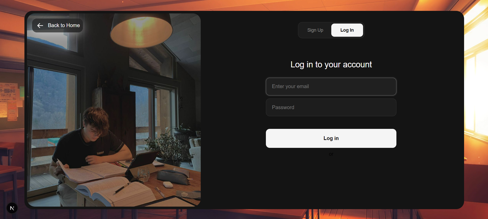
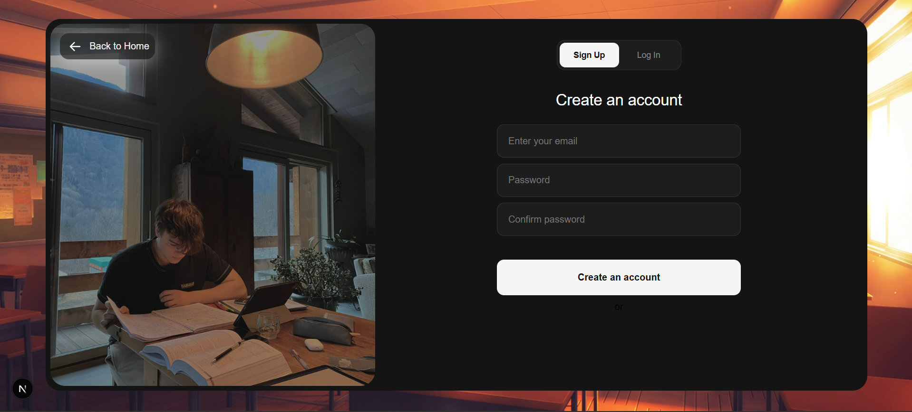
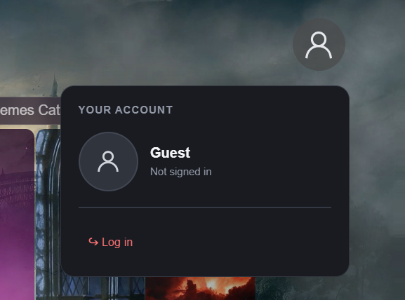
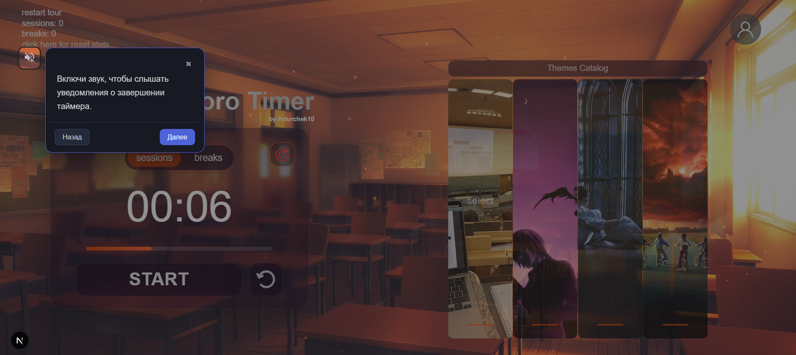
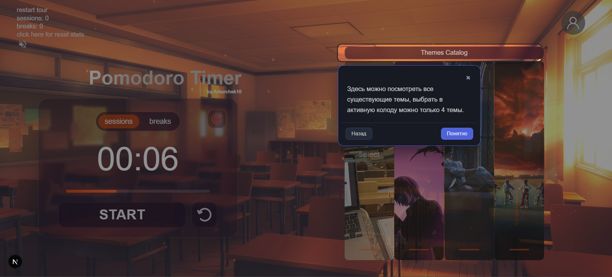

# Pomodoro Timer ⏱️

**Атмосферный Pomodoro-таймер с интерактивными темами, каталогом оформлений и авторизацией.**

Проект для тех, кто хочет сосредоточиться на учёбе или работе в выбранной атмосфере: от учебной аудитории до фэнтезийных и аниме-сцен. Интерфейс таймера меняется при выборе темы, а пользователь может переключаться между рабочими сессиями и перерывами.

> **Статус:** pet project, находится в разработке. README демонстрирует существующие интерфейсы; отдельные backend-функции ещё интегрируются.

## Обзор интерфейса



<details>
<summary>Ещё один вариант оформления главного экрана</summary>



</details>

## Возможности

- **Pomodoro-таймер:** рабочие сессии и перерывы, запуск и сброс, визуальный индикатор прогресса.
- **Тематическое оформление:** смена фона и атмосферы главной страницы.
- **Быстрый выбор тем:** интерактивные карточки тем на главном экране.
- **Каталог тем:** отдельная страница с поиском, фильтрами по жанру, типу анимации и настроению, сортировкой.
- **Онбординг:** пошаговые подсказки при первом знакомстве с приложением, в том числе про звук и каталог тем.
- **Учётная запись:** интерфейсы регистрации, входа и меню профиля; авторизация с помощью Better Auth.
- **Статистика:** отображение количества завершённых сессий и перерывов в интерфейсе.

## Скриншоты

### Каталог тем



### Авторизация

<table>
<tr><th>Вход</th><th>Регистрация</th></tr>
<tr><td></td><td></td></tr>
</table>

### Профиль



### Интерактивное обучение (onboarding)

<table>
<tr><th>Подсказка о звуке</th><th>Подсказка о каталоге</th></tr>
<tr><td></td><td></td></tr>
</table>

## Технологии

| Часть проекта | Технологии |
| --- | --- |
| Frontend | **Next.js 16 (App Router), React, TypeScript** |
| UI | CSS Modules, компоненты интерфейса |
| Авторизация | **Better Auth** |
| Onboarding | **Intro.js** |
| Backend (в разработке) | **NestJS**, REST API |
| База данных | **PostgreSQL** |
| Объектное хранилище (интеграция в разработке) | **MinIO** |
| Контейнеризация | **Docker Compose** |

## Устройство приложения

```text
Пользователь
    │
    ▼
Next.js / React
    ├── Pomodoro Timer
    ├── Themes Catalog
    ├── Onboarding (Intro.js)
    └── Authentication (Better Auth) ── PostgreSQL

Отдельный backend (в процессе интеграции):
NestJS ── REST API ── MinIO (хранение файлов)
```

Frontend и NestJS backend разрабатываются как отдельные части проекта. Backend используется для развития серверных возможностей, в частности для работы с пользовательскими файлами.

## Что я реализовал и изучил

Это мой личный проект. В ходе разработки я:

- Создал интерфейс таймера и систему переключения тем на **React / Next.js**.
- Разработал каталог с карточками, фильтрами и поиском.
- Добавил пошаговое обучение интерфейсу через **Intro.js**, включая сохранение факта прохождения.
- Настроил регистрацию и вход с **Better Auth** и **PostgreSQL**.
- Начал разрабатывать отдельный **NestJS** API и интеграцию **MinIO** для файлов пользователей.
- Работал с клиентскими компонентами, состоянием интерфейса и особенностями SSR в Next.js.

## В разработке

- Завершение загрузки и сохранения аватаров через NestJS / MinIO.
- Развитие личного кабинета и пользовательских настроек.
- Дальнейшее развитие серверной части и хранения пользовательских данных.

## Локальный запуск

В проекте предусмотрены отдельные frontend и backend. Конкретные команды запуска, переменные окружения и конфигурацию Docker следует брать из исходного репозитория: здесь они не приводятся, чтобы не публиковать непроверенные инструкции.

---

*Screenshots show the project UI during development. Theme illustrations are used for demonstration; rights to third-party imagery belong to their respective owners.*
